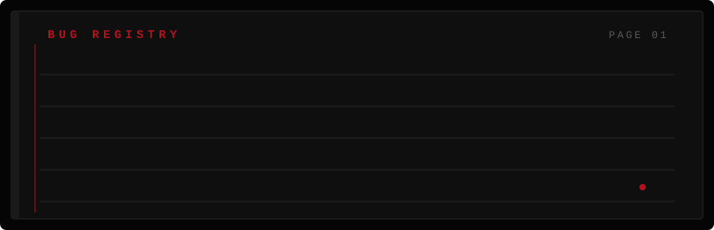

<div align="center">

</div>

<div align="center">


</div>

```text
┌─ RULES OF THIS PROFILE ───────────────────────────┐
│ 01. every bug has a name. find it.                │
│ 02. no commit is ever wasted.                     │
│ 03. if it compiles on the first try, doubt it.    │
│ 04. the snake below eats every contribution.      │
└───────────────────────────────────────────────────┘
```

<div align="center">

</div>

### 🗂️ Case files

| File | Status |
| :-- | :-- |
| [`zip-c-huffman`](https://github.com/daniakhan337-star/zip-c-huffman) — Huffman file compressor in C | `OPEN` |

<div align="center">

</div>